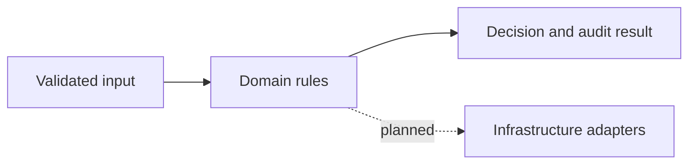

# Cloud Cost Intelligence Dashboard

Saul Chaudry · Personal engineering lab · **Domain prototype**

## Problem and scope
Explore cloud cost intelligence dashboard with clear invariants, failure boundaries and repeatable checks.

## Implemented
Integer-cent billing aggregation, team attribution and baseline anomaly detection.

The core is a local reference implementation. Target technologies below are not all integrated. This is not a production deployment or evidence of employment experience. Cloud availability, cost savings, recovery time and throughput have not been measured.

## Target architecture


Target stack: TypeScript, React, Node.js, PostgreSQL.

## Run the executable checks
Requires Node.js 24. No third-party runtime dependencies are needed for the prototype.
```sh
node --test
```

## Next milestones
- [ ] Billing CSV adapters
- [ ] React dashboard
- [ ] cloud billing ingestion
- [ ] scheduled alerts

## Trade-offs
The domain logic is independent of infrastructure for quick failure-path checks. In-memory prototypes do not coordinate multiple machines or survive restarts. Authentication, persistent state, telemetry and real provider adapters must be verified before production use.

## Evidence and discussion
See `docs/BOUNDARIES.md`. Explain the input contract, failure behavior, consistency model, security boundary and the next integration test. Quote performance results only after recording the commit, workload, runtime, hardware, duration, latency, error rate and limitations.
