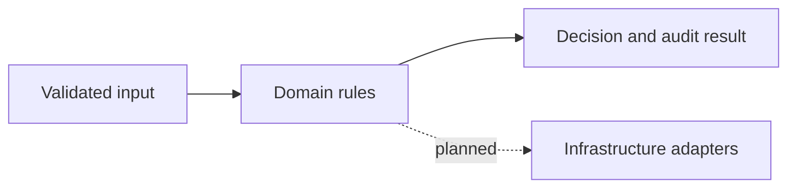

# Centralized Config and Secrets Service

Saul Chaudry · Personal engineering lab · **Domain prototype**

## Problem and scope
Explore centralized config and secrets service with clear invariants, failure boundaries and repeatable checks.

## Implemented
Tenant-scoped configuration revisions, secret references and audit metadata.

The core is a local reference implementation. Target technologies below are not all integrated. This is not a production deployment or evidence of employment experience. Cloud availability, cost savings, recovery time and throughput have not been measured.

## Target architecture


Target stack: Java 21, Spring Cloud Config, Vault.

## Run the executable checks
Requires Java 21. No third-party runtime dependencies are needed for the prototype.
```sh
javac Main.java && java Main
```

## Next milestones
- [ ] Vault adapter
- [ ] Spring Cloud Config transport
- [ ] rotation workflows
- [ ] durable audit storage

## Trade-offs
The domain logic is independent of infrastructure for quick failure-path checks. In-memory prototypes do not coordinate multiple machines or survive restarts. Authentication, persistent state, telemetry and real provider adapters must be verified before production use.

## Evidence and discussion
See `docs/BOUNDARIES.md`. Explain the input contract, failure behavior, consistency model, security boundary and the next integration test. Quote performance results only after recording the commit, workload, runtime, hardware, duration, latency, error rate and limitations.
